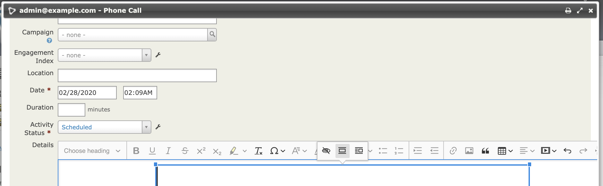
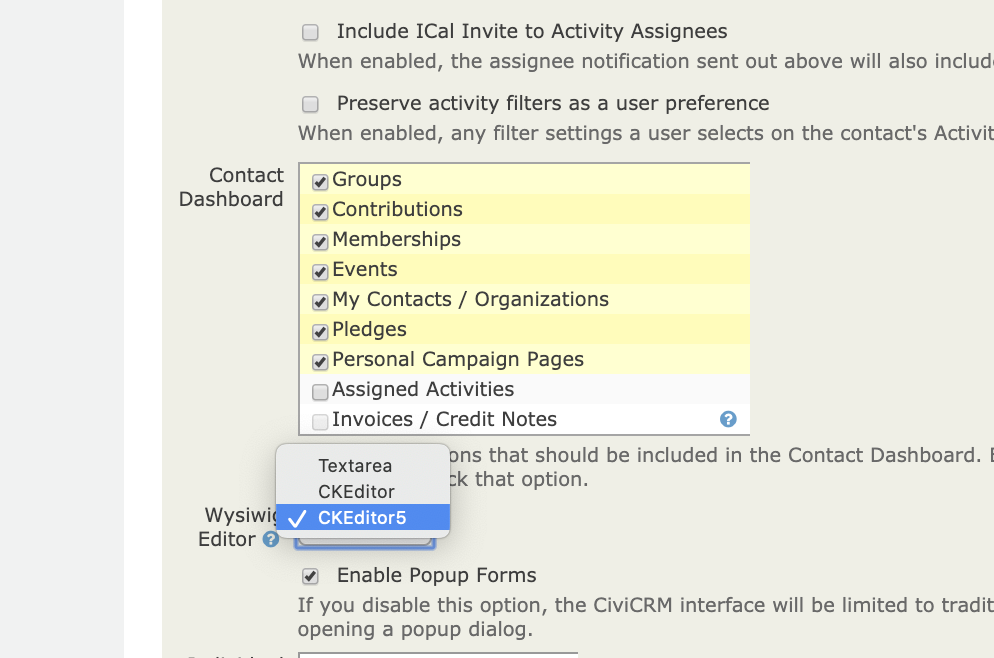

# ckeditor5



This adds ckeditor5 as a usable Wysiwig in CiviCRM. ckeditor5 is better than
ckeditor4 when it comes to inserting formatted text from word / google (note
that you no longer see the paste from Word button as you just paste). Also note
ckeditor5 always uses an expandable window so the field will be small if it has
no data.

Currently the packaged version is useful for sites operating behind
a firewall as it embeds any uploaded images into the html
(as a base64 blob), meaning that images embedded in emails will
not be inaccessible to the recipients.

I also hope to support elfinder integration as an alternative inn future
https://github.com/Studio-42/elFinder#downloads

The extension is licensed under [AGPL-3.0](LICENSE.txt).

## Requirements

* PHP v7.1+
* CiviCRM 5.24+

## Installation (Web UI)

This extension has not yet been published for installation via the web UI.

## Installation (CLI, Zip)

Sysadmins and developers may download the `.zip` file for this extension and
install it with the command-line tool [cv](https://github.com/civicrm/cv).

```bash
cd <extension-dir>
cv dl ckeditor5@https://github.com/FIXME/ckeditor5/archive/master.zip
```

## Installation (CLI, Git)

Sysadmins and developers may clone the [Git](https://en.wikipedia.org/wiki/Git) repo for this extension and
install it with the command-line tool [cv](https://github.com/civicrm/cv).

```bash
git clone https://github.com/FIXME/ckeditor5.git
cv en ckeditor5
```

## Usage

After installation it is  available as an option under
Administer->Customize Data and Screens->Display Preferences



## Known Issues

Configuration
 - a  niche feature of ckeditor4 was a UI for configuration. The toolbar IS configured 
 through a javascript array so it would be  possible to find a way to customise that
 (but there  is  no current plan / demand for this)
- [view source is not a feature in ckeditor5](https://github.com/ckeditor/ckeditor5/issues/592)
- The current implementation does not have a file manager. A file manager allows you to select
 from previously uploaded images on the server and to provide urls to those images in mails rather than
 embedding. My hope is to add a variant  - see
technical discussion below.
- An interesting feature of ckeditor5 is that you can do more Gutenberg-like edit in place.
This would make sense possibly on a contribution page. No current plans.

## A word about builds

ckeditor has a concept of builds constructed with npm. To change some components
(e.g include base64 uploader) it is necessary to used a build. These can be generated
using the [online builder](https://ckeditor.com/ckeditor-5/online-builder/). Alternatively
the classic editor [can be downloaded & installed](https://ckeditor.com/ckeditor-5/download/).
In the latter case there is no build or src directory or additional files.  So far I have just
downloaded & committed these as they come from the above links.

##  File manager

An ongoing challenge with ckeditor4 as implemented with CiviCRM is that the filemanager  (kcfinder)
is pretty hard to work with and requires some hacks to be able to figure out paths.

Ckeditor5 offers the following file managers
- Easy Image & CkFinder -  these  are  not open source
- [Base64 upload](https://ckeditor.com/docs/ckeditor5/latest/features/image-upload/base64-upload-adapter.html)
which is currently packaged & is firewall friendly.
- Integrations. The integration that currently looks most promising is [elFinder](https://github.com/Studio-42/elFinder)
Work on ElFinder integration is currently on the elfinder branch. 

Right now I'm stuck on getting jquery to load in the elfinder promise when it is not part of our global scope. 

Other issues to deal with
1) Ckeditor works with builds - my expectation is we will wind up with several builds shipping
and a setting to choose which one to use - ie firewall friendly vs elfinder
2) We currently need a core fix tweak our settings pages to permit conditional settings based on metadata - ie
only show ckeditor5-specific-settings if $('#editor_id)  = ckeditor5 (this is something)
we also need for invoicing settings).
3) ckeditor builds are generated with npm - it's a bit unclear to me how we deal with that
in extensions (currently committing all the code to the extension). Moving ckeditor4 to a core
extension makes sense but we'd need to figure out this challenge.
